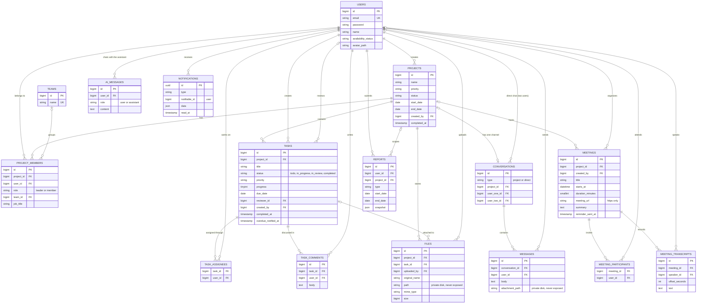

# Data model (ERD)

Rendered by GitHub (Mermaid). Column lists show the keys and the fields that matter for the business rules;
the full definition is in [`SPEC.md`](SPEC.md) §4 and in `database/migrations`.

## Invariants the schema and code protect

| Invariant | Where it is enforced |
|---|---|
| A user appears once per project | `unique(project_id, user_id)` on `project_members` |
| A project always has a leader (R1) | `AddProjectMember` / `UpdateProjectMember` / `RemoveProjectMember` guard |
| Assignees and reviewers belong to the task's project (R3) | request validation + row locks in `LockTaskMembers` |
| A project has exactly one channel (R8) | `unique(project_id)` on `conversations`, created in `CreateProject` |
| One direct chat per pair of users (R8) | lower user id stored first + `unique(user_one_id, user_two_id)` |
| A user is invited once to a meeting / assigned once to a task | `unique` pairs on the pivot tables |
| Stored files are never reachable by path | private disk, random names, authorized download endpoints |
| Deleting a project removes everything under it | foreign keys with `cascadeOnDelete` + storage cleanup in `DeleteProject` |
